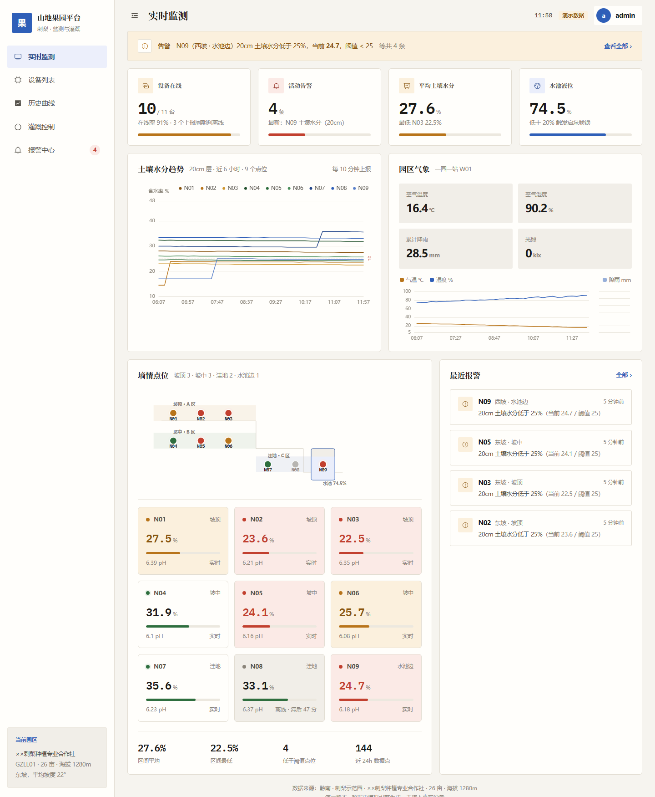
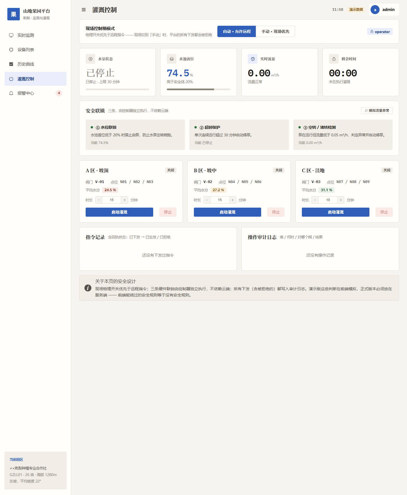
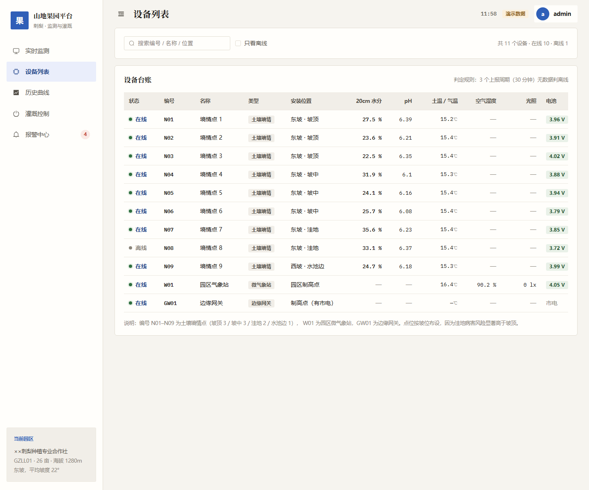
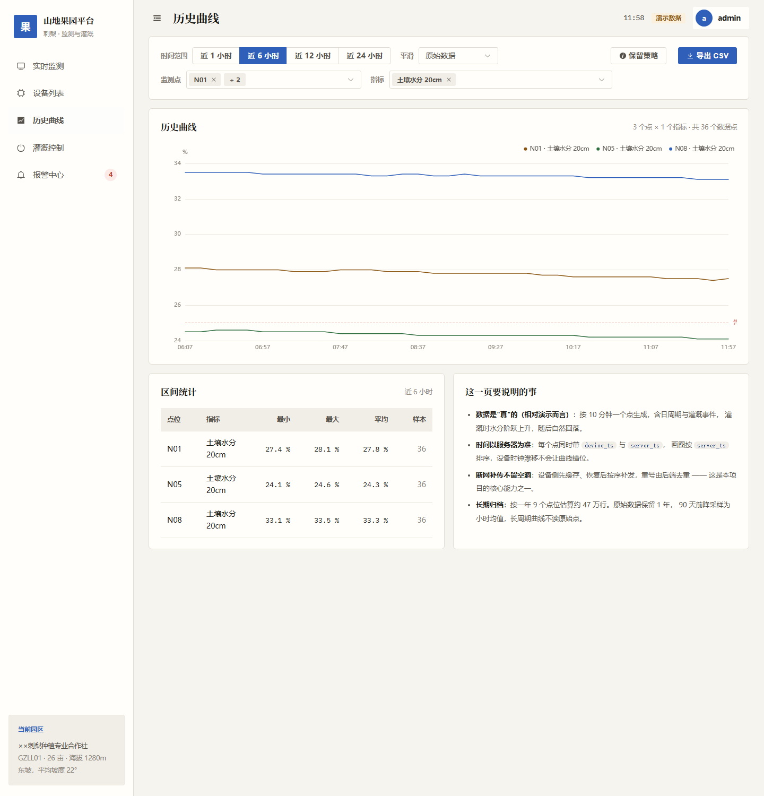
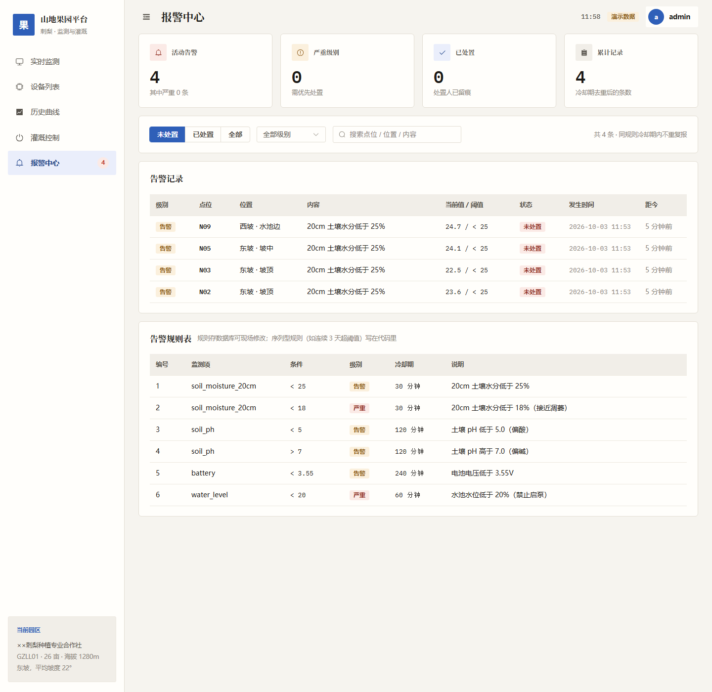

# 山地果园墒情监测与灌溉控制平台（前端演示版）

刺梨园/山地果园的**墒情监测 + 灌溉控制大屏**，Vue 3 + Vite + Element Plus + ECharts 单页应用。

> ⚠️ **演示版**：数据由前端模拟引擎生成，**未接入真实设备与后端**，界面顶部有「演示数据」标识。
> 三条安全联锁目前只在前端模拟，接真实设备前**必须移到服务端**。

[](https://vuejs.org/)
[](https://vitejs.dev/)
[](https://element-plus.org/)
[](https://echarts.apache.org/)
[](./LICENSE)

---

## 界面预览

| 登录 | 实时监测 |
|---|---|
|  |  |

| 灌溉控制 | 设备列表 |
|---|---|
|  |  |

| 历史曲线 | 报警中心 |
|---|---|
|  |  |

完整截图见 [`预览截图/`](预览截图/)。

---

## 最快看到成品：零依赖启动（不需要 Node.js）

Windows 上双击 `①双击启动演示.cmd`，脚本用系统自带的 PowerShell + .NET `HttpListener`
直接服务已构建好的 `orchard-web/dist`，然后自动打开 <http://localhost:8080/>。

演示账号（写在前端代码里）：

| 账号 | 密码 | 权限 |
|---|---|---|
| `admin` | `admin123` | 操作员 —— 可下发灌溉指令 |
| `viewer` | `viewer123` | 访客 —— 只读，控制按钮点不动 |

> 为什么不直接双击 `dist/index.html`：构建产物是 ES module，浏览器对 `file://` 下的模块加载有
> CORS 限制，双击会白屏，必须走 http。

## 用 Node.js 跑（改代码 / 跨平台）

```bash
cd orchard-web
npm install

npm run dev      # 开发模式，热更新，http://127.0.0.1:5173
npm run build    # 重新构建到 orchard-web/dist/
npm run serve    # 零依赖静态服务器（端口 8080，会同时打印局域网地址，手机可看）
```

需要 Node.js 18+（构建用 Node 20 验证通过）。

---

## 功能

| 页面 | 路由 | 内容 |
|---|---|---|
| 实时监测 | `#/monitor` | 4 个 KPI、报警条、9 点水分趋势、园区气象、点位墙、最近报警 |
| 设备列表 | `#/devices` | 11 个设备台账，含**数据滞后时长**列 |
| 历史曲线 | `#/history` | 任选时段/点位/指标，多指标叠加，导出 CSV，保留策略说明 |
| 灌溉控制 | `#/control` | 现场模式开关、三条安全联锁、分区启停、指令回执、审计日志 |
| 报警中心 | `#/alerts` | 告警列表、处置留痕、阈值规则表 |

### 落地了哪些设计决定

- **现场物理开关优先于远程指令**：切到手动后所有远程下发被拒绝并记录原因。
- **权限两级 + 完整审计**：`admin`/`viewer`，审计日志记录谁/何时/对哪个阀/结果/原因。
- **三条安全联锁**：水位 <20% 禁启泵、泵超时 30 分钟自动停、流量 <0.05 判空转堵转。
- **3 个上报周期判离线**：并显示数据滞后时长。
- **时间以服务器为准**：每个数据点同时带 `device_ts` 与 `server_ts`，绘图按 `server_ts` 排序。
- **阈值规则可配置**：告警规则表含冷却期字段。
- **长期归档**：47 万行估算、90 天降采样、原始保留 1 年。

---

## 架构

```
orchard-web/src/
├── main.js                 入口：注册 Element Plus + 深色主题 + 图标
├── App.vue                 外壳：侧边栏 + 顶栏 + 路由出口 + 时钟
├── router/index.js         hash 路由 + 登录守卫
├── styles/theme.css        设计 token 与公共类（色板/字体/圆角/间距/响应式）
├── store/
│   ├── auth.js             登录态与权限（演示版账号写死）
│   ├── audit.js            审计日志（演示版存内存）
│   └── monitor.js          监测数据 store —— 页面只跟它打交道（唯一取数入口）
├── mock/
│   ├── devices.js          设备台账、园区信息、分区、告警规则
│   └── simulator.js        数据模拟引擎（日周期 + 随机游走 + 灌溉事件）
├── components/             BaseChart / KpiCard / PointCard / SlopeProfile
├── utils/                  chart.js 图表主题、echarts.js 按需引入
└── views/                  五个页面
```

**关键设计**：页面不直接碰 `mock/`，只通过 `store/monitor.js` 取数。
接真实后端时**只需要改 `store/monitor.js`**（把模拟引擎换成 `fetch`），五个页面一行都不用动。

## 换成真实后端时要改什么

| 现在（演示） | 换成 |
|---|---|
| `mock/simulator.js` 生成数据 | `fetch('/api/telemetry/history')` |
| `monitor.start()` 里的 `setInterval` | 每 10 秒轮询 `/api/telemetry/latest` |
| 账号写在 `store/auth.js` | 登录接口 + token + 401 拦截 |
| 审计日志存内存 | 落库（`store/audit.js` 字段可直接当表结构） |
| 联锁判断在前端 | **必须移到服务端** —— 前端能绕过的安全规则等于没有安全规则 |
| 控制指令直接改状态 | `POST /api/commands` + 等设备回执（SENT → ACKED / TIMEOUT） |

---

## 目录结构

```
.
├── ①双击启动演示.cmd       零依赖启动器（Windows，推荐先用这个）
├── serve.ps1              启动器实际执行的 PowerShell 静态服务器（只读不改）
├── 使用说明.txt            交付包使用说明（面向非开发同学）
├── 预览截图/               7 张成品界面截图
└── orchard-web/           完整工程
    ├── dist/              已构建好的产物（启动器服务的就是它）
    ├── src/               源码
    ├── preview/           三套视觉风格对比稿（HTML）
    ├── README.md          工程说明 + 5 分钟演示脚本
    ├── HANDOFF.md         视觉重构实施手册
    └── DESIGN-NOTES.md    设计决策依据记录
```

## 已知不足（诚实清单）

1. 数据是假的，不要把界面数字当真实数据对外展示。
2. 交互流程未做自动化验证：页面渲染已逐一截图确认，按钮/弹窗/导出需人工走一遍演示脚本。
3. ECharts 全量打包偏大（约 1 MB，gzip 后 344 KB），可改成按需引入。
4. 深色主题只覆盖了用到的组件，新增 Element Plus 组件可能要补变量。
5. 历史曲线纵轴自适应，只看 6 小时时微小波动会被放大或压平。
6. 只针对桌面/投屏，未做移动端适配。
7. 构建产物必须走 HTTP。

## 许可

[MIT](./LICENSE)。字体 [Noto Serif SC](https://fonts.google.com/noto/specimen/Noto+Serif+SC)、
[IBM Plex Mono](https://www.ibm.com/plex/) 通过 `@fontsource` 打包，遵循各自的开源许可（OFL）。
